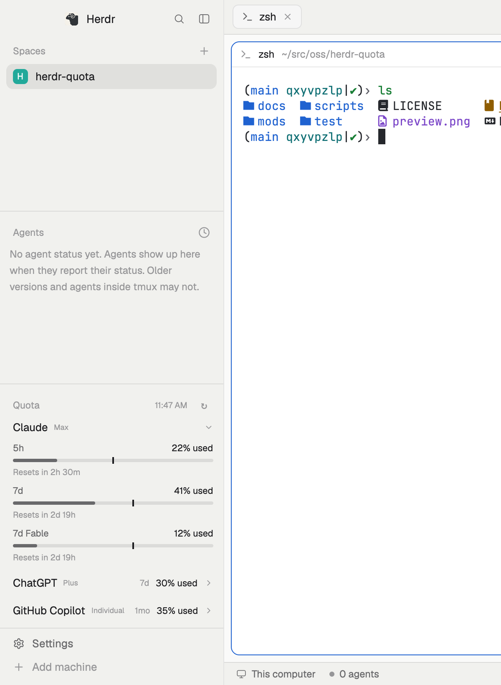
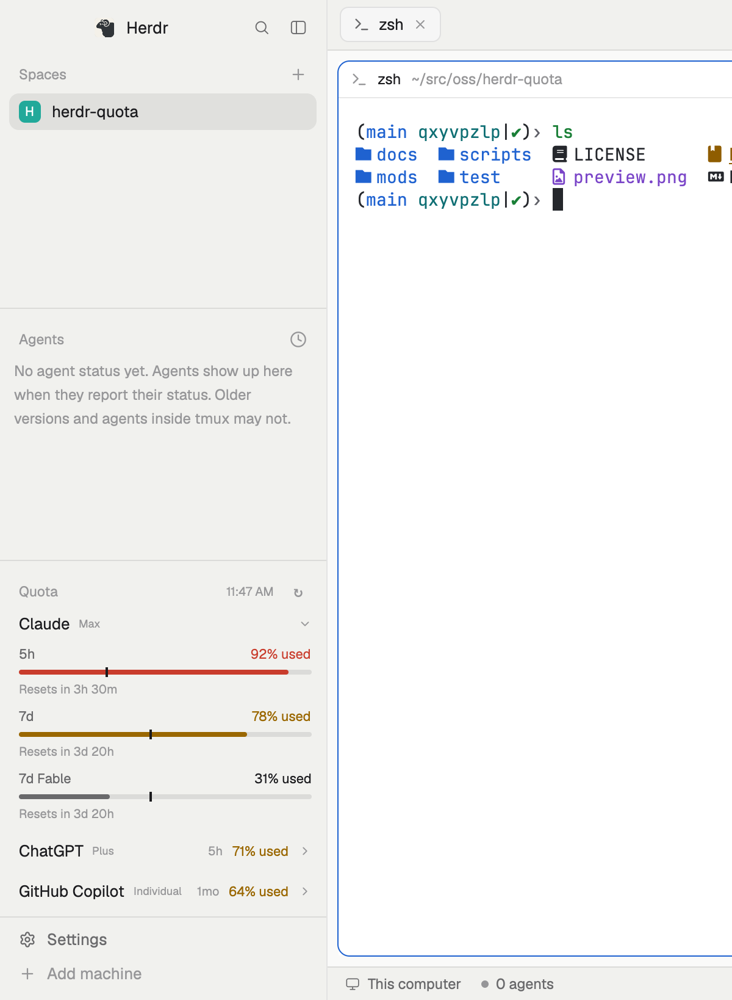

# Herdr Quota

A native Herdr **desktop** sidebar panel for checking remaining subscription usage for Claude Code, ChatGPT, and (experimentally) GitHub Copilot.

The panel starts compact: each provider shows the window that most needs attention and the percentage used in it: one that is nearly used up, otherwise one running ahead of an even pace, otherwise the most used. Click a provider to expand its other quota windows, percentages, and reset times.

The panel sits at the bottom of the sidebar, beneath Agents. These show it with sample data, Claude expanded, in three states:

| Everything within pace | Slightly ahead of pace | Far ahead of pace |
|---|---|---|
|  |  |  |

## Install

### Requirements

- Herdr desktop app
- macOS or Linux. On Linux the Claude sign-in is read from the credentials file, since there is no Keychain. The collector also has a Windows code path (shell-spawned CLIs), but it is untested, and the tests need a POSIX shell.
- Node.js 22 or newer
- Claude Code and/or Codex CLI installed and signed in locally for the providers you want to see
- GitHub CLI (`gh`) installed and signed in with `gh auth login` to try experimental Copilot usage

### With a coding agent

Herdr mods are usually added by asking a coding agent on the same machine. Give it this:

```text
Read ~/.config/herdr-app/AGENTS.md, then add this mod: https://github.com/dstanek/herdr-quota
```

The agent reads [RECIPE.md](RECIPE.md) and every file first, tells you what the mod runs and reaches, copies `mods/quota/` into your Herdr config, and places the panel beneath Agents in a layout you own.

### From a downloaded copy of this project

Open a terminal in the project directory and run:

```sh
node scripts/install.mjs
```

Then switch Herdr to the generated layout:

```sh
herdr-app do layout.switch '{"name":"quota-main"}'
```

The installer copies the mod and its collector to Herdr's mods folder and creates a new `quota-main` layout based on your existing `main` layout, placing Quota beneath Agents. It does not replace your existing layout or overwrite an existing Quota mod/layout. If the mod already exists, use `--upgrade` (below); if only the layout exists, remove or rename it before installing.

The default Herdr config directory is `~/.config/herdr-app`. If Herdr uses a custom directory, set `HERDR_APP_HOME` to that directory when running the installer.

### Upgrade

A plain install will not overwrite an existing one. To update the installed mod from the project directory, run:

```sh
node scripts/install.mjs --upgrade
```

This replaces the mod's files and leaves your layouts as they are; Herdr reloads the mod when the files change.

An upgrade adds and replaces files but never deletes any, so a file dropped from a later version stays in the installed folder. For an exact copy, uninstall and install again; that also recreates the `quota-main` layout, so any edits you made to it are lost.

### Uninstall

```sh
node scripts/install.mjs --uninstall
```

This removes the mod and the generated `quota-main` layout. If Herdr is showing that layout, it is switched back to `main` first. The cache file (`~/.cache/herdr-quota.json`) is left in place; delete it if you want.

### Provider setup

- **Claude:** use your existing Claude Code sign-in. On macOS, the mod reads the `Claude Code-credentials` item from Keychain first, then falls back to `~/.claude/.credentials.json`. Approve Keychain access if macOS prompts. On other platforms it reads the credentials file.
- **ChatGPT:** sign in to ChatGPT in Codex CLI. The mod asks Codex's local app-server for subscription limits; it does not use API-key billing as a substitute.
- **GitHub Copilot (experimental):** install GitHub CLI and run `gh auth login`. The collector asks `gh` to make the request itself (`gh api`), so it never sees your GitHub token.

No Claude settings or status-line changes are required. A provider without a usable sign-in shows a status message rather than an estimated quota.

Copilot usage uses GitHub's undocumented `copilot_internal/user` endpoint. It is best-effort and not a stable or officially supported API; GitHub may change or remove it at any time. Only finite quota buckets with usable remaining percentages are shown.

Claude usage is equally unofficial. The collector sends your Claude Code OAuth token to the undocumented `api.anthropic.com/api/oauth/usage` endpoint and identifies itself as `herdr-quota`. Anthropic may change or remove the endpoint, or stop accepting requests made this way, at any time.

## What it shows

- Short-term and weekly windows when reported by the provider. Each is named by its period, then what it is scoped to: `5h`, `7d`, `7d Opus`. Copilot's monthly premium-request allowance is `1mo`.
- The plan each provider reports (for example Max, Plus, Individual), dimmed beside its name.
- Quota used, reset countdown, and a bar of what is used in expanded details, with a mark for an even pace (see [The pace mark](#the-pace-mark)).
- If a refresh fails, the cached reading is marked "Stale" with its age and the reason.
- When the Claude sign-in has expired, the last reading stays with a dim "Paused until Claude Code next runs". Claude Code renews the sign-in the next time it runs.
- Only provider-reported values. Expired windows are hidden.
- The panel grows and shrinks to fit its rows when it sits in a fixed-height sidebar block, as the installer places it.
- Automatic refresh every five minutes, plus manual refresh from the panel header.

If Claude or Copilot rate-limits requests, the collector backs off for the interval the provider asks for (ten minutes if it gives none). ChatGPT has no backoff; a failed request is simply retried on the next refresh. In every case the last successful reading stays visible with its age. The cache is stored at `~/.cache/herdr-quota.json` (or under `XDG_CACHE_HOME`) and contains quota percentages, reset times, plan names, and fetch timestamps—not credentials.

### The pace mark

Each bar in the expanded details has a small vertical mark. The bar's fill is how much of the quota you have used; the mark is how much of the window's time has passed. If you used quota at a perfectly even rate, the fill would end exactly at the mark.

- **Fill short of the mark:** you are using quota more slowly than the window allows and will not run out at this rate.
- **Fill past the mark:** you are ahead of pace. Halfway through a 5-hour window with 70% used, the mark sits at 50% and the fill runs 20 points beyond it.

The mark moves right as the window runs, so a reading that was ahead of pace can fall back behind it without any quota being returned.

Color follows the same idea. A reading turns amber at 60% used, or earlier when it is 10 or more points ahead of the mark, and red at 85% used. The collapsed row uses this too: it shows a window that is nearly used up, otherwise one that is ahead of pace, otherwise the most used.

A bar has no mark when the provider does not give a reset time or the window's length is not known.

## Troubleshooting

- **No Claude data:** check that Claude Code is signed in. On macOS, approve the Keychain prompt if shown. If Claude reports a sign-in problem, open Claude Code and check its own auth status before retrying.
- **No ChatGPT data:** verify Codex CLI is installed and signed in with a ChatGPT account, not API-key auth.
- **No Copilot data:** verify `gh auth status` succeeds and that the GitHub account has Copilot access. The undocumented endpoint may also fail or change independently of this mod.
- **Rate limited (Claude, Copilot):** the last successful reading remains visible if available. Wait for the displayed retry interval; avoid repeatedly pressing refresh.
- **Switch back to your original layout:** `herdr-app do layout.switch '{"name":"main"}'`.
- **Validate the installed mod:** `herdr-app check ~/.config/herdr-app/mods/quota`.

## Configuration and scope

The collector reads a few environment variables. Herdr runs it with your user environment; restart Herdr after changing one:

| Variable | Effect | Default |
|---|---|---|
| `CLAUDE_CONFIG_DIR` | Directory holding Claude Code's `.credentials.json` | `~/.claude` |
| `CODEX_BIN_PATH` | Codex CLI executable | `codex` on `PATH` |
| `GH_BIN_PATH` | GitHub CLI executable | `gh` on `PATH` |
| `HERDR_QUOTA_CACHE` | Cache file location | `~/.cache/herdr-quota.json` |
| `CLAUDE_SECURITY_COMMAND` | macOS Keychain command; exists for the tests | `/usr/bin/security` |
| `GH_TIMEOUT_MS` | How long to wait for `gh`, in milliseconds; exists for the tests | `10000` |

By default the panel lists all three providers and reads each one's existing local sign-in, so there is nothing to set up. A provider you have never signed in to stays in the list, dimmed and marked "Not signed in".

To show only some providers, or to reorder them, add a `providers` list to the Quota block in your layout (`~/.config/herdr-app/layouts/quota-main.json`). The ids are `claude`, `chatgpt`, and `copilot`; providers left out are not queried at all:

```json
"content": { "mod": "quota", "props": { "providers": ["claude", "chatgpt"] } }
```

The five-minute refresh interval is fixed, and providers always start collapsed.

This is a Herdr desktop mod; the separate Herdr mobile app does not currently run desktop mods.

## Development checks

```sh
for f in scripts/*.mjs mods/quota/*.mjs; do node --check "$f"; done
node --test
herdr-app check mods/quota
```

`node --check` only looks at the first file it is given, hence the loop.

`herdr-app check` also writes `mods/quota/gpui-kit.d.ts`, the editor types for the Herdr version you have installed. That file is generated and ignored by version control.

The tests never touch your real sign-ins: each one points the collector at stand-in CLIs, credentials, and responses in a temporary directory.

## License

MIT. See [LICENSE](LICENSE).
