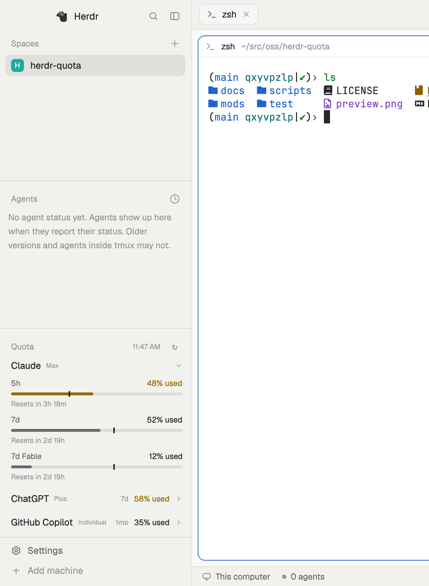

# Herdr Quota

A native Herdr **desktop** sidebar panel for checking remaining subscription usage for Claude Code, ChatGPT, and (experimentally) GitHub Copilot.

The panel starts compact: each provider shows its current short-term window and remaining percentage. Click a provider to expand its other quota windows, percentages, and reset times.



## Install

### Requirements

- Herdr desktop app
- macOS. The collector also has Linux and Windows code paths (a credentials file in place of Keychain, shell-spawned CLIs on Windows), but they are untested, and the tests need a POSIX shell.
- Node.js 22 or newer
- Claude Code and/or Codex CLI installed and signed in locally for the providers you want to see
- GitHub CLI (`gh`) installed and signed in with `gh auth login` to try experimental Copilot usage

### From a downloaded copy of this project

Open a terminal in the project directory and run:

```sh
node scripts/install.mjs
```

Then switch Herdr to the generated layout:

```sh
herdr-app do layout.switch '{"name":"quota-main"}'
```

The installer copies the mod and its collector to Herdr's mods folder and creates a new `quota-main` layout based on your existing `main` layout, placing Quota beneath Agents. It does not replace your existing layout or overwrite an existing Quota mod/layout. If the mod already exists, use `--upgrade` (below); if only the layout exists, remove or rename it before installing.

The default Herdr config directory is `~/.config/herdr-app`. If Herdr uses a custom directory, set `HERDR_APP_HOME` to that directory when running the installer.

### Upgrade

A plain install will not overwrite an existing one. To update the installed mod from the project directory, run:

```sh
node scripts/install.mjs --upgrade
```

This replaces the mod's files and leaves your layouts as they are; Herdr reloads the mod when the files change.

### Uninstall

Switch back to your original layout, then remove the mod and the generated `quota-main` layout:

```sh
herdr-app do layout.switch '{"name":"main"}'
node scripts/install.mjs --uninstall
```

The cache file (`~/.cache/herdr-usage.json`) is left in place; delete it if you want.

### Provider setup

- **Claude:** use your existing Claude Code sign-in. On macOS, the mod reads the `Claude Code-credentials` item from Keychain first, then falls back to `~/.claude/.credentials.json`. Approve Keychain access if macOS prompts. On other platforms it reads the credentials file.
- **ChatGPT:** sign in to ChatGPT in Codex CLI. The mod asks Codex's local app-server for subscription limits; it does not use API-key billing as a substitute.
- **GitHub Copilot (experimental):** install GitHub CLI and run `gh auth login`. The collector obtains a token through `gh auth token`; the token is sent only to GitHub and is not written to the output or cache.

No Claude settings or status-line changes are required. A provider without a usable sign-in shows a status message rather than an estimated quota.

Copilot usage uses GitHub's undocumented `copilot_internal/user` endpoint. It is best-effort and not a stable or officially supported API; GitHub may change or remove it at any time. Only finite quota buckets with usable remaining percentages are shown.

Claude usage is equally unofficial. The collector sends your Claude Code OAuth token to the undocumented `api.anthropic.com/api/oauth/usage` endpoint and identifies itself with a Claude Code user-agent. Anthropic may change or remove the endpoint, or stop accepting requests made this way, at any time.

## What it shows

- Short-term and weekly windows when reported by the provider.
- Remaining quota, reset countdown, and a bar of what is left in expanded details. Readings turn amber at 40% left and red at 15%.
- If a refresh fails, the cached reading is marked "Stale" with its age and the reason.
- Only provider-reported values. Expired windows are hidden.
- The panel grows and shrinks to fit its rows when it sits in a fixed-height sidebar block, as the installer places it.
- Automatic refresh every five minutes, plus manual refresh from the panel header.

If Claude rate-limits requests, the collector backs off for the interval Claude asks for (ten minutes if it gives none). ChatGPT and Copilot have no backoff; a failed request is simply retried on the next refresh. In every case the last successful reading stays visible with its age. The cache is stored at `~/.cache/herdr-usage.json` (or under `XDG_CACHE_HOME`) and contains quota percentages, reset times, plan names, and fetch timestamps—not credentials.

## Troubleshooting

- **No Claude data:** check that Claude Code is signed in. On macOS, approve the Keychain prompt if shown. If Claude reports a sign-in problem, open Claude Code and check its own auth status before retrying.
- **No ChatGPT data:** verify Codex CLI is installed and signed in with a ChatGPT account, not API-key auth.
- **No Copilot data:** verify `gh auth status` succeeds and that the GitHub account has Copilot access. The undocumented endpoint may also fail or change independently of this mod.
- **Rate limited (Claude):** the last successful reading remains visible if available. Wait for the displayed retry interval; avoid repeatedly pressing refresh.
- **Switch back to your original layout:** `herdr-app do layout.switch '{"name":"main"}'`.
- **Validate the installed mod:** `herdr-app check ~/.config/herdr-app/mods/quota`.

## Configuration and scope

The panel itself has no settings. The collector reads a few environment variables, which must be set in the environment Herdr starts with:

| Variable | Effect | Default |
|---|---|---|
| `CLAUDE_CONFIG_DIR` | Directory holding Claude Code's `.credentials.json` | `~/.claude` |
| `CODEX_BIN_PATH` | Codex CLI executable | `codex` on `PATH` |
| `GH_BIN_PATH` | GitHub CLI executable | `gh` on `PATH` |
| `HERDR_USAGE_CACHE` | Cache file location | `~/.cache/herdr-usage.json` |
| `CLAUDE_SECURITY_COMMAND` | macOS Keychain command; exists for the tests | `security` |

The panel always lists all three providers and reads each one's existing local sign-in, so there is no provider setup file to maintain. A provider you have never signed in to stays in the list, dimmed and marked "Not signed in"; it cannot be hidden. The five-minute refresh interval is fixed, and providers always start collapsed.

This is a Herdr desktop mod; the separate Herdr mobile app does not currently run desktop mods.

## Development checks

```sh
for f in scripts/*.mjs; do node --check "$f"; done
node --test
herdr-app check mods/quota
```

`node --check` only looks at the first file it is given, hence the loop.

The tests never touch your real sign-ins: each one points the collector at stand-in CLIs, credentials, and responses in a temporary directory.
