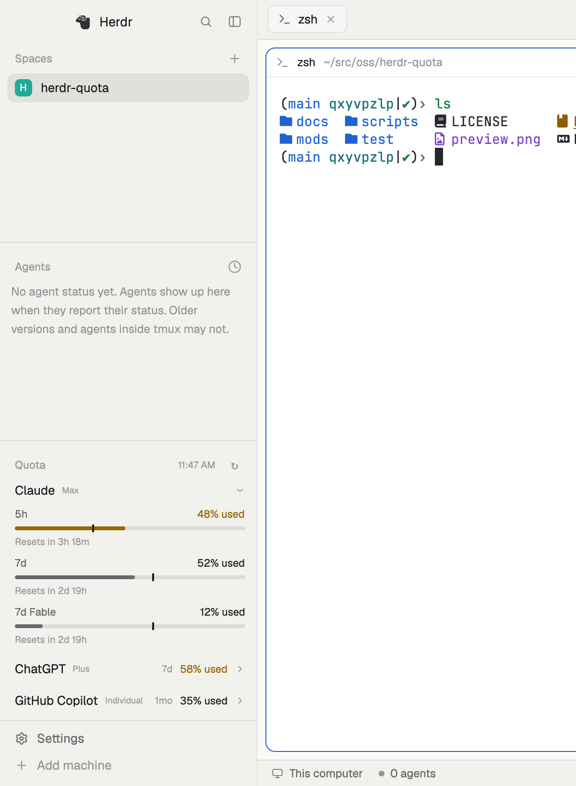

# Quota

A sidebar panel that shows how much of your Claude Code, ChatGPT (Codex) and GitHub Copilot subscription quota is left. Each provider is one line: its name, your plan, the current window and the percentage remaining. Click a provider to see all of its windows with a bar and a reset countdown.



## What you see

A panel the width of the sidebar (built at 268px), sitting directly beneath Agents. It has the sidebar's chrome background and a 1px top border in the border color. Everything is drawn in theme colors, so it follows light and dark themes.

- **Header, 41px tall.** "Quota" at the left, 11.5px, medium weight, dim. At the right, the time of the newest reading (10px, dim, hours and minutes only), then a 26px refresh button showing "↻" with 6px corners. The button gets the hover background and foreground color under the pointer and the tooltip "Refresh quota".
- **One row per provider, 12px apart**, inset 16px from the left and 12px from the right: Claude, ChatGPT, GitHub Copilot. Left to right: the name (13px, semibold), the plan the provider reports with its first letter capitalized (9px, dim, for example "Max", "Plus", "Individual"), then at the right edge the current window's label (10px, dim, for example "5h" or "1mo"), "94% left" (11px, semibold) and an 11px chevron pointing right.
- **An expanded provider** swaps its chevron to point down, drops the label and percentage from its row, and lists every window beneath, 5px apart. Each window is: its label (11px, muted) with "62% left" (11px, semibold) at the right; a 4px bar with 2px corners on a border-colored track, filled to the share that is left; and "Resets in 2h 24m" (10px, dim).
- **Color means attention.** A reading is foreground-colored with a muted bar until 40% is left, the "working" color from 40% down, and the "blocked" color from 15% down.
- **A provider you have never signed in to** has a muted name and "Not signed in" (10px, dim) where the percentage would be. Expanded, it shows one dim 11px line saying which sign-in was not found.
- **A failed refresh** adds one 9.5px line in the "working" color under the provider: how old the reading is, then why, for example "Stale, 47m old · Rate limited; retry in 8m". A provider that fails with no earlier reading shows the reason alone, at 11px.

## How it behaves

- It reads quota when it first appears, every five minutes after that, and when you click refresh. While reading, the header shows "Updating…" in place of the time. With no reading at all it shows "Not updated".
- Countdowns and ages are redrawn every minute between readings.
- Clicking anywhere on a provider's row expands or collapses it. Any number can be open. Providers start collapsed, and the open ones are not remembered across a reload.
- The collapsed row shows the provider's 5-hour window if it has one, otherwise its first window.
- The panel resizes its own layout block to fit its rows, growing when a provider opens and shrinking when it closes. This only happens when the block sits in a column and has a fixed pixel height.
- A reading younger than a minute is reused, so a second refresh inside a minute shows the same numbers.
- When Claude or Copilot answers "rate limited", that provider is left alone for as long as it asks (ten minutes if it does not say) and its last reading stays on screen, marked stale.
- A window whose reset time has passed is hidden until the next successful reading.
- It shows no agent status and binds no keys.

## Built from

One mod, `mods/quota/`:

- `main.js`: the panel.
- `mod.json`: `{ "place": "none", "title": "Quota" }`. It appears only where a layout puts it.
- `collect.mjs` and `claude-credentials.mjs`: the collector, plain Node scripts (Node 22 or newer, no dependencies) that do all the reading and print one JSON object.

There is no `layouts/` folder. To show the panel, add this block to a layout the person owns, immediately after the block with id `agents`, inside the same column. Herdr's shipped `main` cannot have its structure edited in place, so clone it first (`layout.clone {name: "main", as: "quota-main"}`) and edit the clone:

```json
{ "id": "quota", "type": "block", "size": { "px": 220 }, "min": 110, "content": { "mod": "quota" } }
```

Optional prop on that block: `"props": { "providers": ["claude", "chatgpt"] }` chooses and orders the rows from `claude`, `chatgpt`, `copilot`. Providers left out are not queried.

From `herdr` the panel uses `appHome`, `checking`, `exec`, `layout`, `props`, `run("layout.resize", {id, px})` and `theme`, plus `cx.timer.every` for the five-minute and one-minute ticks. Its chevrons are `mods/workspace-chrome/chevron-right.svg` and `chevron-down.svg`.

The panel runs `node <appHome>/mods/quota/collect.mjs [provider ids]` with a 25-second timeout. The collector prints `{ providers, errors, absent }`, where each provider is `{ plan, windows: [{ label, usedPercent, resetsAt }], fetchedAt, stale?, note? }`. It keeps its last readings and any cooldowns in `~/.cache/herdr-quota.json` (or under `XDG_CACHE_HOME`), written with mode 0600.

What the collector reaches, per provider:

- **Claude.** Reads the Claude Code sign-in: on macOS by running `security find-generic-password -s "Claude Code-credentials" -w`, falling back to `~/.claude/.credentials.json`; elsewhere from that file. Sends the access token to `https://api.anthropic.com/api/oauth/usage` with `anthropic-beta: oauth-2025-04-20` and the user-agent `herdr-quota/<version>`. The plan comes from the sign-in's `subscriptionType`.
- **ChatGPT.** Runs `codex app-server --stdio` and asks it, over JSON-RPC, `initialize`, `account/read` and `account/rateLimits/read`. It never sees a Codex credential.
- **Copilot.** Runs `gh auth token`, then sends that token to `https://api.github.com/copilot_internal/user`. The plan is `copilot_plan`; the reset date is `quota_reset_date_utc`.

Environment overrides: `CLAUDE_CONFIG_DIR`, `CODEX_BIN_PATH`, `GH_BIN_PATH`, `HERDR_QUOTA_CACHE`, and `CLAUDE_SECURITY_COMMAND` (for tests).

## Watch out

- **Tell the person before adding it.** This mod reaches the network (Anthropic and GitHub), runs programs (`node`, `security`, `codex`, `gh`) and reads a file outside its folder (Claude Code's credentials). No token is written to the cache, to the collector's output or to a log.
- **Two of the three endpoints are undocumented.** Anthropic's `oauth/usage` and GitHub's `copilot_internal/user` can change or disappear without notice. Copilot buckets marked unlimited, or without a usable percentage, are skipped.
- **`node` must be on the path Herdr runs programs with.** Without it the panel shows the failure in the "working" color at the bottom.
- **The folder name `quota` is assumed twice in `main.js`:** in the collector path and in the search for the panel's own layout block. If the mod is renamed to avoid a clash, change both.
- **The Claude token is never refreshed.** Claude Code does that when it runs. An expired sign-in is reported as "Claude sign-in expired; run claude to refresh it".
- **macOS may ask for Keychain access.** The collector waits three seconds; if the read fails and only an old credentials file is left, it says so instead of calling the sign-in expired.
- **This runtime ignores the options passed to `toLocaleTimeString`**, so the header strips the seconds itself.
- **`init()` runs during `herdr-app check`.** The refresh returns early when `checking()` is true, so a check never runs the collector.
- **Without a fixed pixel height in a column, the panel does not resize itself**; it scrolls instead.
- **Built and run on macOS only.** The collector has Linux and Windows paths that have not been exercised.

## Done when

- `herdr-app check mods/quota` passes.
- `node mods/quota/collect.mjs` exits 0 and prints JSON with `providers`, `errors` and `absent`, even on a machine with nothing signed in.
- The panel shows a row for each chosen provider, with a percentage for every provider that is signed in and "Not signed in" for the rest.
- Clicking a row lists its windows and the block grows to fit; clicking again shrinks it back.
- Clicking refresh shows "Updating…" and then a time.
- `~/.cache/herdr-quota.json` contains percentages, reset times, plan names and timestamps, and no token.
